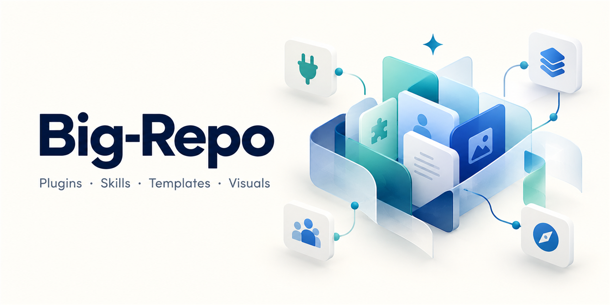
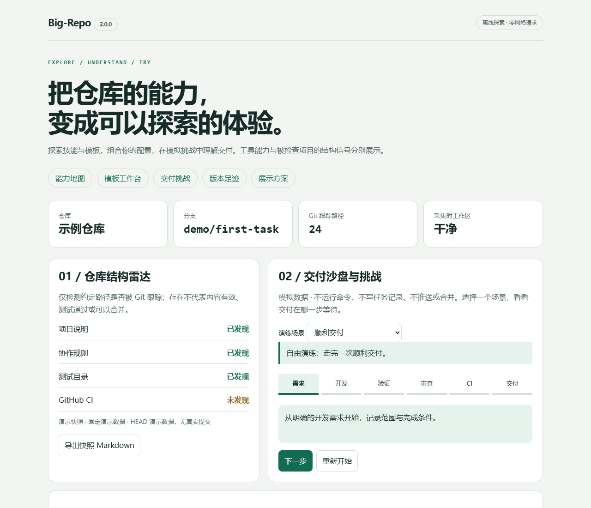
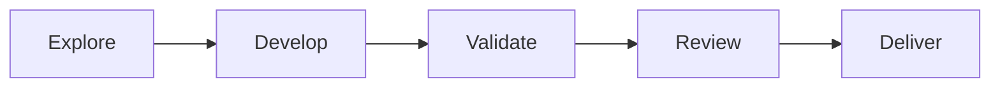

# Big-Repo

<!-- big-repo:badges:start -->
[](https://github.com/HaoYangJin/Big-Repo/actions/workflows/check.yml)
[](https://github.com/HaoYangJin/Big-Repo/actions/workflows/release.yml)
<!-- big-repo:badges:end -->

English · [简体中文](README.md)



**Start with a clear repository. Keep it useful as it grows. Deliver with evidence.**

Big-Repo is a repository toolkit for AI coding clients: 8 skills, 6 templates, a recoverable maintenance and delivery workflow, and an offline interactive playground. The client understands requests and develops changes; Python tools manage configuration, validation, tasks and GitHub delivery.

[Capabilities](#four-starting-points) · [Quick start](#quick-start) · [Playground](#more-than-star-history) · [Installation](docs/install.md) · [2.0 migration](docs/migration.md)

## Four starting points

| Category | What it does | Start here |
| --- | --- | --- |
| Plugin | Create or onboard projects; validate, record independent review, commit, push, open PRs and merge according to policy; resume interrupted tasks | [Workflow](references/project-workflow.md) |
| Skills | Six maintenance skills plus Git commits and skill authoring; each skill folder is portable | [8 skills](skills/README.md) |
| Templates | Skill drafts, commit messages, tasks, evidence, handoffs and showcase checklists | [6 templates](templates/README.md) |
| Visuals and interaction | Capability map, template composer, delivery sandbox, challenges, release timeline and repository showcase | [Playground guide](docs/showcase.md) |

### Eight skills

| Skill | When to use it | Result |
| --- | --- | --- |
| `repo-intake` | Create a project or onboard an existing repository | Project policy, configuration, portable runtime and initial showcase |
| `maintenance-delivery` | Features, defects, test or CI feedback | Validated and independently reviewed commits, PRs or merges |
| `repo-audit` | Inspect collaboration, testing, maintenance and release workflows | Evidence-based findings; read-only by default |
| `skill-maintenance` | Revise or review existing agent skills | Clear triggers, self-contained resources and verification |
| `repo-showcase` | Create and maintain repository presentation | Real navigation, charts, media and interactive entry points |
| `release-preparation` | Prepare a release or publish an explicitly authorized version | Release materials, migration notes and verified publication |
| `git-commit` | Organize changes and commit | Precise staging and project-compliant commit messages |
| `skill-authoring` | Author reusable task skills | Portable, independently copyable skill folders |

## Quick start

Requires Python 3.11+ and Git. Creating or delivering to GitHub also requires authenticated `gh`. Development and independent review require a capable AI client.

**Try it without GitHub authentication:**

```sh
python scripts/explore.py --demo --output ../Big-Repo-demo.html
# Capture your repository structure; a report is not live monitoring
python scripts/explore.py --repo . --output ../Big-Repo-report.html
```

Open the generated HTML in a browser. Use a new output path each time; existing reports are never overwritten. You can also download the [fixed demonstration](docs/big-repo-explorer.html) and open it locally.

**Onboard an existing project in your AI client:**

> Read Big-Repo's skills/repo-intake/SKILL.md. Enable maintenance and delivery for this project, identify validation, CI and branch rules, and add an appropriate showcase. For later requests or feedback, complete the task according to project policy.

**Create a project:**

> Use Big-Repo to create the project. Prepare its README, delivery rules and offline playground before the first commit. I will explicitly provide the repository identifier and visibility if a GitHub remote is needed.

The client invokes `scripts/project_workflow.py create` or `init`. Configuration, runtime files and managed instructions can be shared with the project; task logs and evidence stay in Git metadata. Missing validation or CI information remains a configuration prerequisite. File creation alone is not successful onboarding. See [commands and recovery](references/project-workflow.md).

## More than Star History

- **Capability map:** filter skills, templates and tools by goal; inspect prerequisites and copy invocation prompts.
- **Template workbench:** combine, preview, copy or download drafts; replace all prompts before use.
- **Delivery sandbox and challenges:** explore successful delivery, failing tests, blocking review and pending CI; reveal hints, resolve simulated blockers, finish and replay.
- **Version timeline:** inspect CHANGELOG entries and a verified Release snapshot, with source candidates distinguished from published versions.
- **Showcase library:** growth, status, media, quick trials, community participation and project history, including dependencies and maintenance costs.



The playground needs no server, account or network. Exports and challenges stay in the browser and execute no real commit, merge or release. Completion is not validation evidence. Big-Repo capabilities are separate from structural signals about the inspected project. The interactive interface and detailed guides currently use Simplified Chinese.

Creation and onboarding prepare a managed showcase and offline demo. Later maintenance synchronizes affected content before the final commit. Public repositories may use real charts and badges; private or unknown visibility uses local content. No background polling or scheduled task is added.

## Repository map

| Directory | Contents |
| --- | --- |
| [skills/](skills/README.md) | All 8 skills |
| [templates/](templates/README.md) | All 6 templates and replacement instructions |
| [scripts/](docs/development.md) | Runtime, packaging, research and release scripts |
| [assets/](docs/showcase.md) | Capability catalog, offline UI, screenshots and brand image |
| [references/](references/project-workflow.md) | Workflow, shared protocols and source summaries |
| [docs/](docs/README.md) | Installation, use, development, migration and validation |
| [research/](research/README.md) | Evidence from 60 repositories, not 60 installable tools |
| [tests/](docs/development.md) | Automated and browser checks |

## Installation, boundaries and contributing

See [installation](docs/install.md) for checksums, upgrades and rollback, and [migration](docs/migration.md) for legacy configuration and tasks. The machine ID is now `big-repo`; existing global installations are not silently replaced.

Delivery endpoints are local commit, PR and verified merge. Narrower user requests, project rules and platform protections take precedence. Publishing requires an explicitly authorized version; deployment and global installation need their own authorization.

[Releases](https://github.com/HaoYangJin/Big-Repo/releases) · [Changelog](CHANGELOG.md) · [Validation limits](docs/validation.md) · [Contributing](CONTRIBUTING.md) · [Historical records](docs/archive/README.md)

<!-- big-repo:showcase:start -->
## Project navigator

- [README](README.md)

Explore → Develop → Validate → Review → Deliver



- [Big-Repo offline playground](docs/big-repo-explorer.html)

[Releases](https://github.com/HaoYangJin/Big-Repo/releases) · [Issues](https://github.com/HaoYangJin/Big-Repo/issues)

### Star History


[文字入口：查看星标历史](https://www.star-history.com/#HaoYangJin/Big-Repo&Date)

Third-party star data; not downloads, quality or active users.
<!-- big-repo:showcase:end -->
