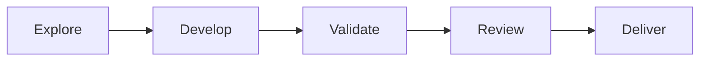

# Big-Repo

[English](README.en.md) · 简体中文


**创建时就有门面，开发时持续维护，交付时有据可查。**

Big-Repo 是给 AI 编程客户端使用的仓库工具箱：8 个技能、6 个模板、一套可恢复的维护交付流程，以及无需服务器的离线交互体验。客户端负责理解需求和开发；Python 工具管理配置、验证、任务及 GitHub 交付。

[功能目录](#四个入口) · [快速开始](#快速开始) · [交互体验](#不止-star-history) · [安装与升级](docs/install.md) · [2.0 迁移](docs/migration.md)

## 四个入口

| 分类 | 能做什么 | 入口 |
| --- | --- | --- |
| 插件功能 | 新建或接入项目；验证、独立审查、提交、推送、PR、按策略合并；中断后恢复 | [工作流](references/project-workflow.md) |
| 技能 | 6 个维护技能 + Git 提交、技能编写；每个目录可独立复制 | [8 个技能](skills/README.md) |
| 模板 | 技能草稿、提交说明、任务、证据、交接、展示清单 | [6 个模板](templates/README.md) |
| 仓库玩法 | 能力地图、模板组合、交付沙盘、挑战、版本时间线、状态与增长展示 | [玩法说明](docs/showcase.md) |

### 8 个技能解决哪些问题

| 技能 | 使用场景 | 结果 |
| --- | --- | --- |
| `repo-intake` | 新仓库创建、已有项目首次接入 | 项目规则、配置、完整运行文件、初始展示 |
| `maintenance-delivery` | 开发需求、缺陷、测试或 CI 反馈 | 经过验证与审查的提交、PR 或合并结果 |
| `repo-audit` | 检查协作、测试、维护与发布流程 | 有证据的审查结论，默认只读 |
| `skill-maintenance` | 修改或评审已有 AI 技能 | 清晰的触发条件、自包含资源和验证 |
| `repo-showcase` | 建立和维护仓库门面与体验 | 真实导航、图表、媒体与可玩入口 |
| `release-preparation` | 准备版本，或获明确授权后发布指定版本 | 发布材料、迁移说明及核验后的发行 |
| `git-commit` | 整理改动与提交 | 精确暂存、符合约定的提交说明 |
| `skill-authoring` | 编写可复用的任务技能 | 可随目录独立复制的技能 |

## 快速开始

需要 Python 3.11+、Git。GitHub 创建与交付另需已认证的 `gh`，实际开发和独立审查需要支持这些操作的 AI 客户端。

**先体验，无需 GitHub 认证：**

```sh
python scripts/explore.py --demo --output ../Big-Repo-demo.html
# 采集自己的仓库结构；报告不是实时监控
python scripts/explore.py --repo . --output ../Big-Repo-report.html
```

用浏览器打开生成的 HTML。每次使用新输出路径，工具不会覆盖旧报告。也可下载仓库内的 [固定演示页](docs/big-repo-explorer.html) 后本地打开。

**在 AI 客户端中接入已有项目：**

> 请读取 Big-Repo 的 skills/repo-intake/SKILL.md，为当前项目启用维护与交付，识别验证、CI 和分支规则，并补齐仓库展示。以后我只提开发需求或反馈，请按项目策略完成本轮交付。

**新建项目：**

> 请用 Big-Repo 创建项目，先建立 README、交付规则和离线体验入口，再组织首次提交。若要创建 GitHub 远端，我会明确提供仓库标识和可见性。

客户端调用 `scripts/project_workflow.py create` 或 `init`。项目配置、运行目录和托管说明可随项目共享；任务、日志和证据保存在 Git 元数据中。缺少验证或 CI 信息时会报告待配置，不能把初始化文件存在当作配置完成。[命令与恢复](references/project-workflow.md)。

## 不止 Star History

- **能力地图**：按目标筛选技能、模板和工具，查看前提与调用示例，复制提示语。
- **模板工作台**：组合模板、预览、复制或下载草稿；替换提示项后再使用。
- **交付沙盘与挑战**：体验顺利交付、测试失败、审查阻塞和 CI 等待；查看提示、解除模拟阻塞、通关、重玩。
- **版本足迹**：展示 CHANGELOG 与已核实 Release 快照，区分源码候选和已发布版本。
- **展示方案库**：增长、状态、媒体、快速体验、社区参与和项目故事，说明各自依赖与维护方式。


页面不需要服务器、账号或网络。模板导出与挑战只发生在浏览器中，不执行真实提交、合并或发布；通关不是验证证据。工具能力与目标项目的结构信号分别展示。

首次创建或接入时生成托管展示区和离线演示；后续维护在最终提交前同步受影响内容。公开仓库可加入真实图表与徽章，私有或公开性未知时使用本地内容，不设置后台巡检或定时任务。

## 文件在哪里

| 目录 | 内容 |
| --- | --- |
| [skills/](skills/README.md) | 全部 8 个技能 |
| [templates/](templates/README.md) | 全部 6 个模板及替换说明 |
| [scripts/](docs/development.md) | 运行、打包、研究和发行脚本 |
| [assets/](docs/showcase.md) | 能力目录、离线页面、截图与品牌图 |
| [references/](references/project-workflow.md) | 工作流、共享协议和来源摘要 |
| [docs/](docs/README.md) | 安装、使用、开发、迁移与验收 |
| [research/](research/README.md) | 60 个仓库的研究证据，不是 60 个可安装工具 |
| [tests/](docs/development.md) | 自动化和浏览器验收 |

## 安装、边界与贡献

完整安装、校验、升级与回退见 [安装说明](docs/install.md)，旧版配置与任务迁移见 [迁移说明](docs/migration.md)。内部 ID 已改为 `big-repo`；旧版本安装不会被静默替换。

交付终点支持本地提交、PR、验证后合并。用户本轮更窄限制、项目规则和平台保护优先。版本发布需要明确版本授权，部署与全局安装另行授权。

[实际 Releases](https://github.com/HaoYangJin/Big-Repo/releases) · [变更记录](CHANGELOG.md) · [验证范围](docs/validation.md) · [贡献说明](CONTRIBUTING.md) · [历史记录](docs/archive/README.md)

<!-- big-repo:showcase:start -->
## 项目导航

- [README](README.md)

接入 → 开发 → 验证 → 独立审查 → 交付



- [Big-Repo 离线体验台](docs/big-repo-explorer.html)

[Releases](https://github.com/HaoYangJin/Big-Repo/releases) · [Issues](https://github.com/HaoYangJin/Big-Repo/issues)

[](https://github.com/HaoYangJin/Big-Repo/actions/workflows/check.yml)

[](https://github.com/HaoYangJin/Big-Repo/actions/workflows/release.yml)

### Star History


[文字入口：查看星标历史](https://www.star-history.com/#HaoYangJin/Big-Repo&Date)

图表来自第三方服务，反映其可用数据；不是下载量、质量或使用人数。
<!-- big-repo:showcase:end -->
